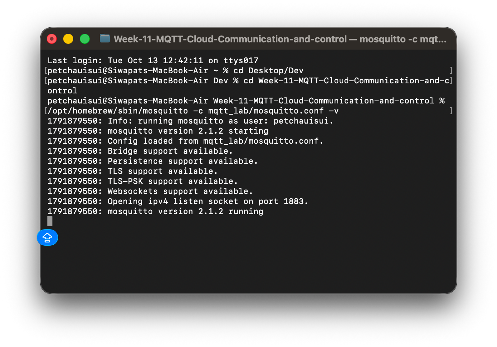
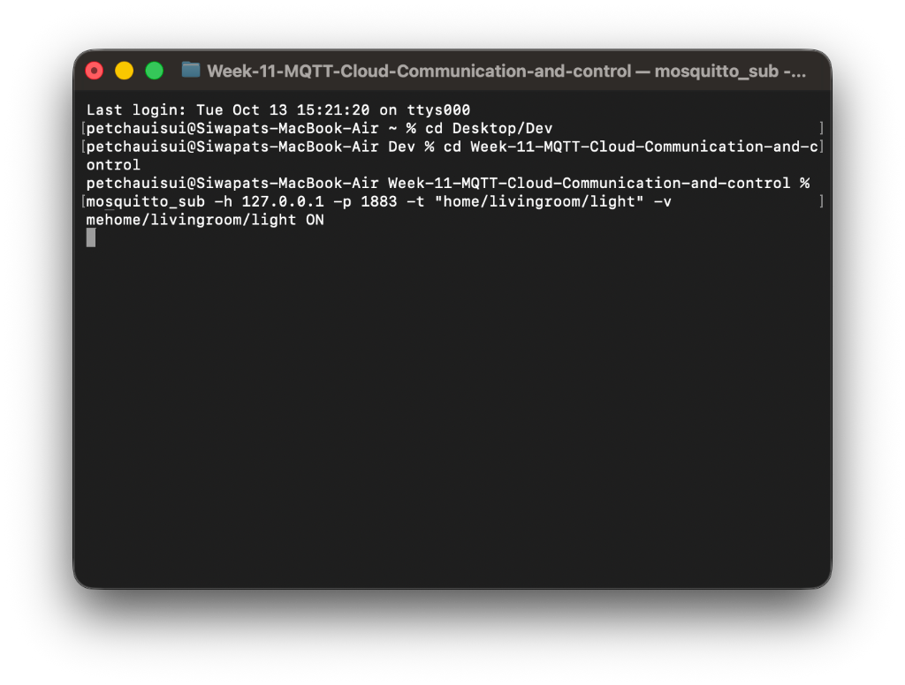
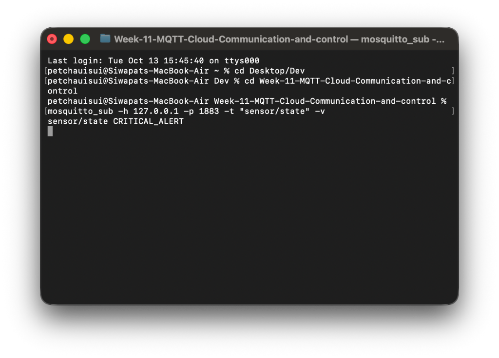

# ใบงานการทดลองที่ 11.1
## การติดตั้ง Mosquitto Broker และการทดสอบโปรโตคอล MQTT ด้วย CLI (Pub/Sub, QoS, Retain, LWT)

---

## 4. การบันทึกและวิเคราะห์ผลการทดลอง

ให้นักศึกษาบันทึกภาพหน้าจอ (Screenshots) และตอบคำถามต่อไปนี้ลงในรายงาน
1. ภาพหน้าจอการทำงานของ Mosquitto Broker Verbose Log ขณะที่มีการเชื่อมต่อและ Subscribe ข้อความ
### รูปภาพ
1. Mosquitto Broker ในโหมด Verbose (-v)

2. Subscriber เพื่อเชื่อมต่อและ Subscribe

2. ตารางเปรียบเทียบลำดับแพ็กเก็ตที่เกิดขึ้นระหว่าง QoS 0, QoS 1 และ QoS 2 ที่สังเกตได้จาก Broker Log

| ระดับ QoS | การทำงาน | แพ็กเก็ตที่รับ-ส่ง (Publisher -> Broker) | ลำดับ Log ที่ขึ้นในหน้าจอ Broker | ผลการสังเกตจากการทดลอง |
| :---: | :--- | :--- | :--- | :--- |
| **QoS 0** | At Most Once (ส่งแบบไม่รอการตอบกลับ) | • `PUBLISH` อย่างเดียว | 1. `Received PUBLISH` 2. `Sending PUBLISH` ไปที่ Subscriber | ไม่มีการตอบรับ Ack ใดๆ และค่า Message ID เป็น 0 (`m0`) ข้อความถูกส่งผ่านไปเฉยๆ |
| **QoS 1** | At Least Once (ส่งอย่างน้อย 1 ครั้ง มีการยืนยัน) | 1. `PUBLISH` 2. `PUBACK` (ตอบกลับ) | 1. `Received PUBLISH ... (q1, m1)` 2. `Sending PUBACK ... (Mid: 1)` 3. `Sending PUBLISH ... (q1, m1)` 4. `Received PUBACK ... (Mid: 1)` | มีการระบุ Message ID (`m1`) ชัดเจน และ Broker จะส่ง `PUBACK` กลับไปยืนยันกับคนส่งทันที |
| **QoS 2** | Exactly Once (ส่งถึงครั้งเดียวแน่นอน ไม่ซ้ำ) | 1. `PUBLISH` 2. `PUBREC` 3. `PUBREL` 4. `PUBCOMP` | 1. `Received PUBLISH ... (q2, m1)` 2. `Sending PUBREC` 3. `Received PUBREL` 4. `Sending PUBCOMP` | มีกระบวนการ 4-way handshake ครบชุดเพื่อยืนยันว่าได้รับข้อความแน่นอนและไม่รับซ้ำซ้อน |

3. ภาพการทดสอบ Retained Message เมื่อเปิด Subscriber ขึ้นมาใหม่

## 5. คำถามท้ายการทดลอง (Post-Lab Questions)
1. เพราะเหตุใดสัญลักษณ์ `#` จึงต้องวางไว้ที่ตำแหน่งท้ายสุดของ Topic เสมอ? หากกำหนด Topic Filter เป็น `home/#/light` จะเกิดข้อผิดพลาดอย่างไร?
   * **ตอบ** เพราะตามข้อกำหนดของโปรโตคอล MQTT ตัว `#` เป็น Multi-level Wildcard ที่ใช้จับคู่ทุกระดับชั้นย่อยที่เหลือทั้งหมดจนสุดพาธ จึงต้องวางไว้ท้ายสุดเสมอ หากเรากำหนดเป็น `home/#/light` จะถือว่าผิดหลักไวยากรณ์ (Invalid Topic Filter) ส่งผลให้ Broker ปฏิเสธคำขอ Subscribe หรือตัดการเชื่อมต่อทันที หากต้องการแทนที่เฉพาะระดับชั้นตรงกลางเพียงระดับเดียว ต้องเปลี่ยนไปใช้ Single-level Wildcard คือเครื่องหมาย `+` แทน (เช่น `home/+/light`)

2. ในระบบงานติดตามยานพาหนะ (GPS Tracking) ที่ส่งพิกัดรถยนต์ทุกๆ 1 วินาที ท่านคิดว่าควรเลือกระดับ QoS ใดระหว่าง QoS 0, 1 หรือ 2 เพราะเหตุใด?
   * **ตอบ** ควรเลือกใช้ **QoS 0 (At Most Once)** เนื่องจากระบบส่งข้อมูลพิกัดถี่มากทุกๆ 1 วินาที ข้อมูลมีความเป็น Real-time สูง หากมีข้อมูลหลุดหายไประหว่างทาง พิกัดของวินาทีถัดไปก็จะถูกส่งมาอัปเดตแทนที่ทันที การใช้ QoS 0 ช่วยประหยัดแบนด์วิดท์และลดภาระของเครือข่าย เพราะหากไปใช้ QoS 1 หรือ 2 จะต้องมีกระบวนการส่งแพ็กเก็ต Acknowledgment ยืนยันกันตลอดเวลา และหากสัญญาณเน็ตมือถือไม่ดี อาจเกิดการส่งข้อมูลซ้ำ (Retransmission) จนเกิดปัญหาคอขวดและข้อมูลดีเลย์สะสมได้

3. หาก Client ส่งแพ็กเก็ต `DISCONNECT` ไปยัง Broker อย่างถูกต้องก่อนปิดโปรแกรม ข้อความ Last Will and Testament (LWT) จะถูกเผยแพร่ออกไปหรือไม่ เพราะเหตุใด?
   * **ตอบ** **ไม่ถูกเผยแพร่** เนื่องจากกลไก LWT มีไว้สำหรับแจ้งเตือนสถานะกรณีที่ Client ขาดการเชื่อมต่อไปอย่างผิดปกติกะทันหันเท่านั้น (Ungraceful Disconnection เช่น ไฟดับ เน็ตหลุด หรือโปรแกรมแครช) แต่ถ้า Client มีการส่งแพ็กเก็ต `DISCONNECT` ไปยัง Broker ก่อนปิด จะถือว่าเป็นการตัดการเชื่อมต่ออย่างถูกต้องตามปกติ (Graceful Disconnection) ตัว Broker ก็จะลบข้อความ LWT นั้นทิ้งทันทีโดยไม่ส่งกระจายต่อไปยัง Subscriber

4. Retained Message มีประโยชน์อย่างไรในการออกแบบระบบแดชบอร์ด Smart Home สำหรับผู้ใช้งานที่เพิ่งเปิดแอปพลิเคชันขึ้นมาเป็นครั้งแรก?
   * **ตอบ** มีประโยชน์อย่างมากในการช่วยแก้ปัญหา **หน้าจอว่างเปล่า (Blank Dashboard)** ตอนที่เปิดแอปพลิเคชันขึ้นมาครั้งแรก เพราะอุปกรณ์ IoT ในบ้านหลายตัว (เช่น สวิตช์ไฟ เซนเซอร์ประตู) จะส่งข้อมูลเฉพาะตอนที่มีการเปลี่ยนแปลงสถานะ (Event-driven) หรือส่งทุกๆ ช่วงเวลานานๆ หากไม่มี Retained Message ผู้ใช้เปิดแอปขึ้นมาจะไม่รู้สถานะของหลอดไฟหรือประตูเลยจนกว่าอุปกรณ์จะส่งรอบใหม่เข้ามา แต่เมื่อใช้ Retained Message ทาง Broker จะเก็บค่าล่าสุดไว้ในหน่วยความจำ และส่งสถานะปัจจุบันให้แอปพลิเคชันทราบทันทีที่ Subscribe ทำให้แดชบอร์ดแสดงสถานะได้ทันทีโดยไม่ต้องรอ