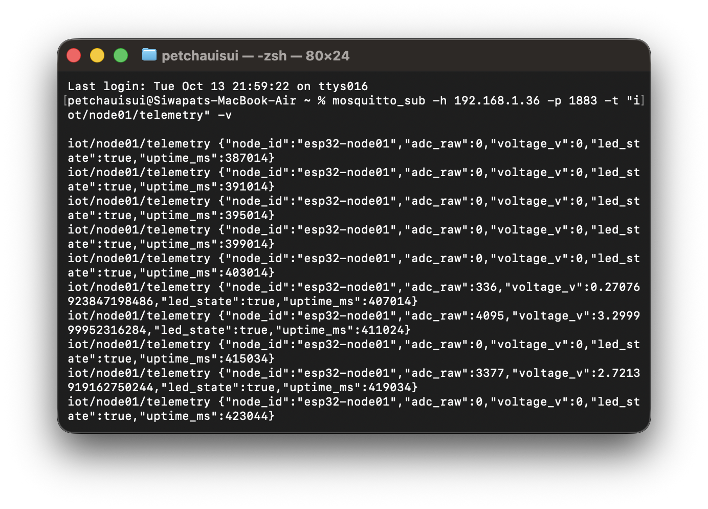
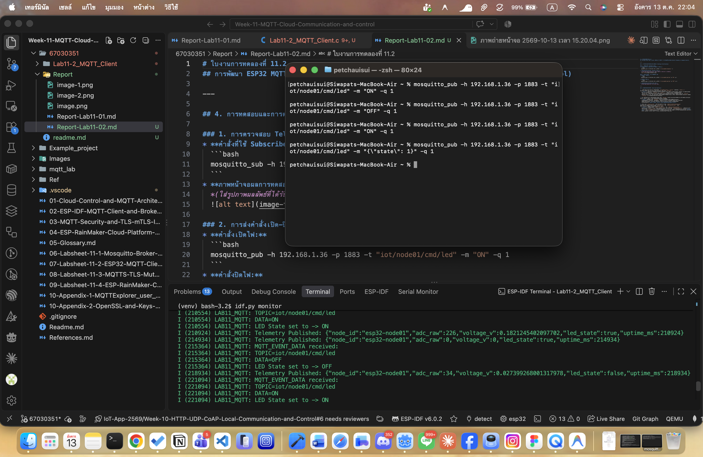

# ใบงานการทดลองที่ 11.2
## การพัฒนา ESP32 MQTT Client สำหรับส่งข้อมูลเทเลเมทรีและรับคำสั่งควบคุม (Telemetry & Command Control)

---

## 4. การทดสอบและการตรวจสอบผลลัพธ์ (Testing & Verification)

### 1. การตรวจสอบ Telemetry Data
* **คำสั่งที่ใช้ Subscribe ดูข้อมูลเซนเซอร์**
  ```bash
  mosquitto_sub -h 192.168.1.36 -p 1883 -t "iot/node01/telemetry" -v
  ```
* **ภาพหน้าจอผลการทดสอบ Telemetry Data**
  *(ใส่รูปภาพผลลัพธ์ที่ได้รับ JSON ข้อมูลเซนเซอร์ทุกๆ 4 วินาที)*


### 2. การส่งคำสั่งเปิด-ปิดหลอดไฟ LED
* **คำสั่งเปิดไฟ**
  ```bash
  mosquitto_pub -h 192.168.1.36 -p 1883 -t "iot/node01/cmd/led" -m "ON" -q 1
  ```
* **คำสั่งปิดไฟ**
  ```bash
  mosquitto_pub -h 192.168.1.36 -p 1883 -t "iot/node01/cmd/led" -m "OFF" -q 1
  ```
* **ภาพหน้าจอผลการทดสอบควบคุม LED**
  *(ใส่รูปภาพผลลัพธ์การเปิด-ปิดไฟ LED)*


**วิดีโอการทดสอบควบคุม LED**
> https://drive.google.com/file/d/1lSDZsGpqgPr4lt4sd50tCfSEuNTqESZP/view?usp=sharing
---

## 5. คำถามท้ายการทดลอง (Post-Lab Questions)

1. เพราะเหตุใดเราจึงต้องส่งข้อความสถานะ `iot/node01/status = "online"` ด้วยแฟล็ก `retain = 1` ควบคู่กับการตั้งค่า Last Will and Testament (LWT) ว่า `"offline"`
   * **ตอบ** เพื่อให้ระบบหรือหน้าแดชบอร์ดรู้สถานะของบอร์ด ESP32 ได้ตลอดเวลาครับ ตอนที่เปิดเครื่องและต่อ MQTT ติด ตัวบอร์ดจะส่ง `"online"` แบบ `retain = 1` เพื่อให้ Broker จำสถานะล่าสุดไว้ เวลาเราเพิ่งเปิดแอปหรือแดชบอร์ดขึ้นมาทีหลังก็จะรู้ทันทีว่าบอร์ดกำลังทำงานอยู่ ส่วน LWT `"offline"` มีไว้ดักกรณีฉุกเฉิน เช่น บอร์ดไฟดับ หรือเน็ตหลุดกะทันหัน Broker จะตรวจเจอว่าบอร์ดหลุด แล้วจะส่งข้อความ `"offline"` ไปบอกคนอื่นแทนตัวบอร์ดทันทีครับ

2. หากเครือข่าย Wi-Fi หลุดชั่วคราว คอมโพเนนต์ `esp-mqtt` มีพฤติกรรมการจัดการอย่างไร และเมื่อสัญญาณกลับมา โค้ดจำเป็นต้องเรียกฟังก์ชันเชื่อมต่อใหม่ด้วยตนเองหรือไม่
   * **ตอบ** ตัวคอมโพเนนต์ `esp-mqtt` จะตรวจจับได้ว่าหลุด และจะพยายาม Reconnect ให้อัตโนมัติในเบื้องหลังเป็นระยะครับ เมื่อสัญญาณ Wi-Fi กลับมาและ ESP32 ได้ IP อีกครั้ง ตัวไลบรารีก็จะต่อเข้า Broker และกลับไป Subscribe หัวข้อเดิมให้เองโดยอัตโนมัติ ดังนั้นในโค้ดจึง**ไม่จำเป็นต้องเรียกฟังก์ชันเชื่อมต่อใหม่ด้วยตนเองครับ**

3. ในฟังก์ชัน `telemetry_task` เพราะเหตุใดหลังจากเรียก `cJSON_PrintUnformatted(root)` แล้วเราจึงจำเป็นต้องเรียกฟังก์ชัน `free(json_str)` และ `cJSON_Delete(root)` เสมอ? หากละเลยจะมีผลเสียอย่างไรต่อหน่วยความจำของ ESP32
   * **ตอบ** เพราะทั้งคำสั่ง `cJSON_CreateObject()` และ `cJSON_PrintUnformatted()` มีการจองแรมแบบไดนามิกบน Heap memory (malloc) ครับ เราจึงต้องสั่ง `cJSON_Delete(root)` เพื่อลบโครงสร้าง JSON และสั่ง `free(json_str)` เพื่อคืนหน่วยความจำสตริงกลับให้ระบบ ถ้าเราลืมคืนแรม จะเกิดปัญหา **Memory Leak** เพราะฟังก์ชันนี้ทำงานวนลูปทุกๆ 4 วินาที แรมก็จะถูกกินไปเรื่อยๆ จนกระทั่งหน่วยความจำหมด แล้วบอร์ด ESP32 ก็จะแครช (Crash) หรือเกิด Panic จนรีสตาร์ตตัวเองวนลูปครับ
