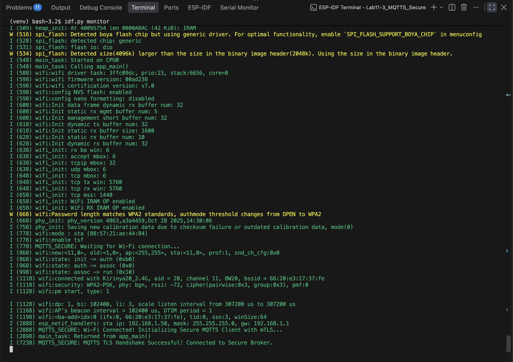
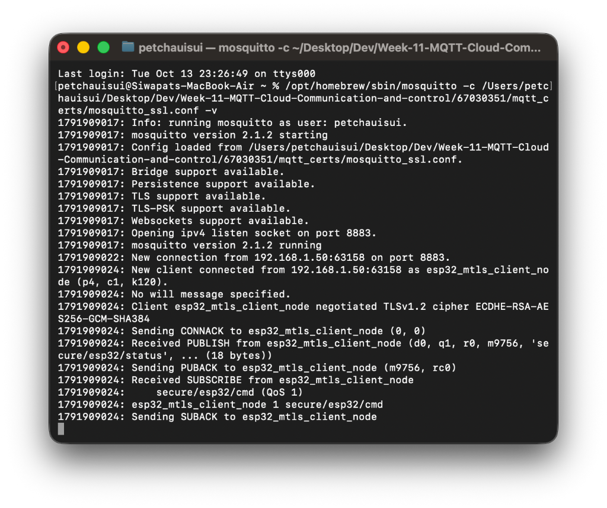

# ใบงานการทดลองที่ 11.3
## การสื่อสาร MQTT ความปลอดภัยสูงด้วย TLS และการยืนยันตัวตนสองทาง (mTLS) บน Mosquitto และ ESP-IDF

---

## 4. การทดสอบและการตรวจสอบผลลัพธ์ (Testing & Verification)

### 1. การแฟลชโปรแกรมและสังเกตผลในหน้าต่าง Serial Monitor
* **คำสั่งที่ใช้ในการแฟลชและดู Monitor**
  ```bash
  idf.py -p /dev/cu.usbserial-xxx flash monitor
  ```
* **สิ่งที่สังเกตได้จากหน้าต่าง Serial Monitor**
  * บอร์ด ESP32 เชื่อมต่อ Wi-Fi สำเร็จและได้รับ IP Address
  * เริ่มต้นกระบวนการเชื่อมต่อและทำ TLS Handshake `Connecting to 192.168.1.36:8883...`
  * หน้าจอรายงานสถานะสำเร็จ `MQTTS TLS Handshake Successful! Connected to Secure Broker.`
  * ทำการส่งสถานะ `secure/esp32/status = SECURE_ONLINE_MTLS` และ Subscribe หัวข้อ `secure/esp32/cmd`
* **ภาพหน้าจอ Serial Monitor (ESP-IDF Monitor)**
  

---

### 2. การสังเกตผลลัพธ์ในหน้าต่าง Mosquitto Broker Log (Verbose Mode)
* **สิ่งที่สังเกตได้จาก Broker Log**
  * มีการเชื่อมต่อเข้ามาที่พอร์ต 8883 (พอร์ตความปลอดภัย)
  * Broker ทำการตรวจสอบใบรับรองของ ESP32 และพิมพ์ข้อความยืนยัน
    ```text
    Peer certificate verified: /C=TH/ST=Bangkok/O=IoT Node/CN=esp32-secure-node
    ```
  * แสดงว่า Broker ตรวจสอบใบรับรองของบอร์ด ESP32 ผ่านเรียบร้อย และอนุญาตให้เชื่อมต่อพร้อมรับ-ส่งข้อมูลแบบเข้ารหัส
* **ภาพหน้าจอ Mosquitto Broker Log**
  

---

## 5. คำถามท้ายการทดลอง (Post-Lab Questions)

1. เพราะเหตุใดในคำสั่งสร้าง Server CSR ค่า Common Name (CN) จึงต้องระบุเป็น IP Address หรือ Hostname ของ Broker ให้ตรงกันพอดี? หากระบุเป็นชื่ออื่นจะเกิดข้อผิดพลาดใดขึ้น?
   * **ตอบ** เพราะในกระบวนการจับมือ TLS (TLS Handshake) ตัว Client (บอร์ด ESP32) จะนำ IP หรือ Hostname ที่เราสั่งต่อเข้าไป ไปเปรียบเทียบกับค่า Common Name (CN) ที่ระบุอยู่ในใบรับรองของ Server ว่าตรงกันหรือไม่ เพื่อป้องกันการถูกดักจับหรือสวมรอยจากเครื่องอื่น (Man-in-the-Middle Attack) ครับ 
     * หากเราระบุ CN เป็นชื่ออื่นที่ไม่ตรงกับ IP จริงของ Broker ตัว Client จะมองว่าใบรับรองนี้ไม่ใช่ของ Server ปลายทางที่ต้องการต่อจริงๆ และจะเกิดข้อผิดพลาด **Hostname Mismatch / Certificate Verification Failed** ทำให้กระบวนการจับมือ TLS ล้มเหลวและตัดการเชื่อมต่อทันทีครับ

2. การยืนยันตัวตนแบบ Mutual Authentication (mTLS) แตกต่างจากการใช้ HTTPS ทั่วไปบนเว็บเบราว์เซอร์อย่างไรในประเด็นเรื่องใบรับรองฝั่ง Client?
   * **ตอบ** แตกต่างกันตรงที่ **HTTPS ทั่วไปเป็นการยืนยันตัวตนทางเดียว (One-way TLS)** ครับ คือมีแค่ฝั่ง Server เท่านั้นที่ต้องมีใบรับรองมาแสดงให้เบราว์เซอร์ตรวจสอบ ส่วนฝั่ง Client (เครื่องเรา) ไม่จำเป็นต้องมีใบรับรองดิจิทัลใดๆ ใช้เพียงการล็อกอินด้วย Username/Password
     * แต่ใน **mTLS (Mutual Authentication)** จะเป็นการ **ยืนยันตัวตนแบบสองทาง (Two-way Authentication)** ซึ่งนอกจาก Client จะตรวจใบรับรองของ Server แล้ว ตัว Server (Mosquitto Broker) ก็จะบังคับตรวจใบรับรองของฝั่ง Client (`client.crt`) ด้วยเช่นกัน หาก Client เครื่องไหนไม่มีใบรับรองที่เซ็นต์โดย Root CA ที่ถูกต้อง Broker จะตัดการเชื่อมต่อทิ้งทันที จึงช่วยป้องกันอุปกรณ์แปลกปลอมไม่ให้เข้ามาในระบบได้อย่างสมบูรณ์แบบครับ

3. หากมีผู้ไม่หวังดีขโมยไฟล์เฟิร์มแวร์ไบนารี (`.bin`) ของบอร์ด ESP32 ไปได้ เขาจะสามารถกู้คืนไฟล์ `client.key` ได้หรือไม่ และในระบบ IoT เชิงพาณิชย์เรามีฮาร์ดแวร์ความปลอดภัยใด (เช่น ESP32 Secure Boot / Flash Encryption / Digital Signature Peripheral) มาช่วยแก้ไขปัญหานี้?
   * **ตอบ** 
     * **สามารถกู้คืนได้ครับ** เพราะคำสั่ง `EMBED_TXTFILES` ใน CMake จะนำเนื้อหาของ `client.key` ไปฝังลงใน Flash memory ตรงๆ ในรูปแบบข้อความธรรมดา (Plaintext) หากผู้ไม่หวังดีดัมป์ไฟล์ไบนารี (`.bin`) ออกมาจาก Flash ได้ ก็สามารถใช้คำสั่งเปิดอ่านสตริง (เช่น คำสั่ง `strings`) ดึง Private Key ออกมาเพื่อสวมรอยเป็นอุปกรณ์ของเราได้ทันที
     * **ฮาร์ดแวร์ความปลอดภัยในเชิงพาณิชย์ที่นำมาแก้ปัญหานี้**
       1. **Flash Encryption** ระบบเข้ารหัสข้อมูลใน Flash memory ด้วยคีย์ระดับฮาร์ดแวร์ (AES-XTS) ทำให้ถึงแม้จะถูกดัมป์ไฟล์ `.bin` ออกไปได้ ข้อมูลที่ได้ไปก็จะเป็นข้อมูลที่ถูกเข้ารหัสและอ่านไม่ออก
       2. **Secure Boot** ระบบตรวจสอบลายเซ็นดิจิทัลของเฟิร์มแวร์ก่อนบูตทุกครั้ง เพื่อป้องกันไม่ให้มีใครแก้ไขหรือแฟลชเฟิร์มแวร์แปลกปลอมลงบนบอร์ด
       3. **Digital Signature Peripheral (DS) ร่วมกับ eFuse** เป็นโมดูลฮาร์ดแวร์พิเศษใน ESP32 ที่ใช้เก็บกุญแจลับไว้ใน eFuse โดยตรง ทำให้ไม่มีใคร (รวมถึงซอฟต์แวร์) สามารถอ่านคีย์ออกมาได้ แต่ตัวฮาร์ดแวร์จะทำการคำนวณและถอดรหัส/เซ็นชื่อดิจิทัลในขั้นตอน TLS Handshake ให้เองโดยอัตโนมัติ ทำให้กุญแจไม่รั่วไหลแน่นอนครับ
