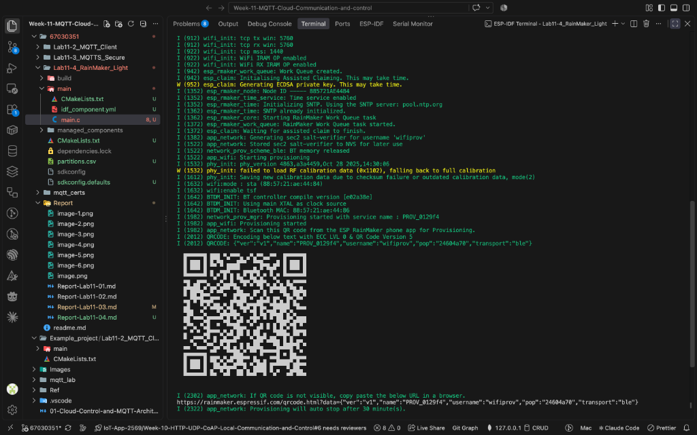
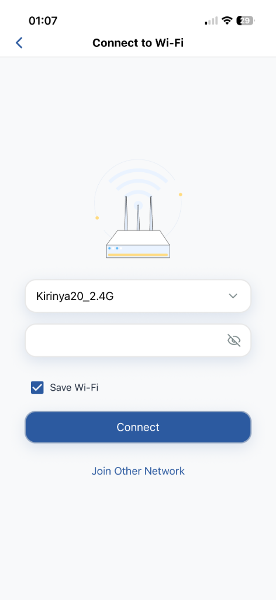

# ใบงานการทดลองที่ 11.4
## การสร้างอุปกรณ์ Smart Light สู่ระบบคลาวด์ด้วย ESP RainMaker SDK, BLE Provisioning และการควบคุมผ่านสมาร์ตโฟน

---

## 4. การทดสอบและการตรวจสอบผลลัพธ์ (Testing & Verification)

### 1. การจับคู่และ Provisioning ผ่านแอปพลิเคชัน ESP RainMaker
* **ขั้นตอนการทำ**
  * แฟลชโปรแกรมลงบอร์ด ESP32 และเปิดหน้าต่าง Serial Monitor
  * สแกน QR Code ที่แสดงบนหน้าจอผ่านแอปพลิเคชัน **ESP RainMaker** บนโทรศัพท์มือถือ
  * ยืนยันกระบวนการ Assisted Claiming เพื่อรับใบรับรองจากคลาวด์ผ่านบลูทูธ (BLE)
  * เลือก Wi-Fi 2.4 GHz และกรอกรหัสผ่านเพื่อให้อุปกรณ์เชื่อมต่อออกสู่อินเทอร์เน็ต
* **ภาพหน้าจอ Serial Monitor (QR Code & BLE Advertising)**



* **ภาพหน้าจอ Mobile App ขณะทำการเคลมอุปกรณ์สำเร็จ (Assisted Claiming)**


* **ภาพหน้าจอ Mobile App ขณะตั้งค่า Wi-Fi Provisioning**



---

### 2. การควบคุมเปิด-ปิดและปรับความสว่างผ่าน Mobile App (Wi-Fi LAN)
* **ผลการทดสอบ**
  * กดสวิตช์ Power บนแอปพลิเคชัน หลอดไฟ LED บนบอร์ดเปิด-ปิดตามทันที
  * เลื่อนแถบ Brightness ปรับความสว่าง บอร์ดได้รับค่าและแสดง Log บน Serial Monitor ถูกต้อง
* **Log ผลลัพธ์ใน Serial Monitor ขณะรับคำสั่งควบคุม Power และ Brightness ผ่าน RainMaker Cloud**
  ```text
  I (88842) esp_rmaker_param: Received params: {"Living Room Light":{"Power":true}}
  I (88842) RMAKER_LIGHT: Request received via: Cloud
  I (88852) RMAKER_LIGHT: Device: Living Room Light | Param: Power
  I (88852) RMAKER_LIGHT: Changing LED state to: ON
  I (88862) esp_rmaker_param: Reporting params: {"Living Room Light":{"Power":true}}
  I (90892) esp_rmaker_param: Received params: {"Living Room Light":{"Power":false}}
  I (90892) RMAKER_LIGHT: Request received via: Cloud
  I (90892) RMAKER_LIGHT: Device: Living Room Light | Param: Power
  I (90902) RMAKER_LIGHT: Changing LED state to: OFF
  I (90902) esp_rmaker_param: Reporting params: {"Living Room Light":{"Power":false}}
  I (96102) esp_rmaker_param: Received params: {"Living Room Light":{"Brightness":95}}
  I (96102) RMAKER_LIGHT: Request received via: Cloud
  I (96112) RMAKER_LIGHT: Device: Living Room Light | Param: Brightness
  I (96122) RMAKER_LIGHT: Changing Brightness to: 95%
  I (96122) esp_rmaker_param: Reporting params: {"Living Room Light":{"Brightness":95}}
  I (97742) esp_rmaker_param: Received params: {"Living Room Light":{"Brightness":40}}
  I (97752) RMAKER_LIGHT: Request received via: Cloud
  I (97752) RMAKER_LIGHT: Device: Living Room Light | Param: Brightness
  I (97762) RMAKER_LIGHT: Changing Brightness to: 40%
  I (97772) esp_rmaker_param: Reporting params: {"Living Room Light":{"Brightness":40}}
  I (101332) esp_rmaker_param: Received params: {"Living Room Light":{"Brightness":100}}
  I (101342) RMAKER_LIGHT: Request received via: Cloud
  I (101342) RMAKER_LIGHT: Device: Living Room Light | Param: Brightness
  I (101342) RMAKER_LIGHT: Changing Brightness to: 100%
  I (101352) esp_rmaker_param: Reporting params: {"Living Room Light":{"Brightness":100}}
  ```


---

### 3. การควบคุมระยะไกลข้ามอินเทอร์เน็ต (Remote 4G/5G Test)
* **ผลการทดสอบ**
  * ปิด Wi-Fi บนโทรศัพท์มือถือแล้วเปิดเฉพาะอินเทอร์เน็ตเซลลูลาร์ 4G/5G
  * ทดลองกดสั่งเปิด-ปิดหลอดไฟ บอร์ด ESP32 ที่บ้านยังคงตอบสนองต่อคำสั่งได้อย่างรวดเร็วผ่าน AWS IoT Cloud
* **ภาพหน้าจอการควบคุมผ่าน 4G/5G** <br>
  


### วิดีโอการทดลอง เปิด - ปิด LED ผ่านแอปพลิเคชัน ESP RainMaker
> https://drive.google.com/file/d/1amFyz83NcxbrHG8aTsEGdNR-9DBdwaXj/view?usp=sharing
---

## 5. คำถามท้ายการทดลอง (Post-Lab Questions)

1. ในสถาปัตยกรรม ESP RainMaker กระบวนการ **Assisted Claiming** ช่วยแก้ปัญหาเรื่องการติดตั้งใบรับรองความปลอดภัย (Security Certificates) บนอุปกรณ์ในขั้นตอนพัฒนาต้นแบบได้อย่างไร?
   * **ตอบ** ช่วยให้ไม่ต้องมานั่งสร้างใบรับรองและแฟลชลงบอร์ดเองทีละตัวเหมือนตอนทำแล็บ 11.3 ครับ เพราะระบบ Assisted Claiming จะใช้แอปบนมือถือช่วยดึงใบรับรองความปลอดภัยจาก Cloud ของ RainMaker มาให้ แล้วส่งผ่านบลูทูธ (BLE) เข้าไปบันทึกลงชิป ESP32 ให้เองตอนที่เราสแกน QR Code เพื่อต่อ Wi-Fi ทำให้ตอนทดลองทำโปรเจกต์ เราไม่ต้องยุ่งยากกับการจัดการ Certificate หรือใส่ Private Key เองในโค้ด บอร์ดก็เชื่อมต่อออกเน็ตแบบเข้ารหัสได้เลยครับ

2. เพราะเหตุใดฟังก์ชัน `write_cb` จึงต้องเรียกคำสั่ง `esp_rmaker_param_update_and_report()` ทุกครั้งที่มีการเปลี่ยนแปลงค่าพารามิเตอร์?
   * **ตอบ** เพราะพอเรากดสั่งงานแล้วบอร์ดเปลี่ยนสถานะไฟเสร็จ เราต้องส่งค่าสถานะใหม่กลับไปบอก Cloud ด้วยครับ เพื่อให้หน้าจอแอปบนมือถืออัปเดตสถานะของสวิตช์และแถบความสว่างให้ตรงกับหลอดไฟจริงบนบอร์ด ถ้าเราไม่เรียกคำสั่งนี้ หลอดไฟบนบอร์ดอาจจะเปิดแล้ว แต่หน้าจอในแอปจะยังค้างอยู่ที่สถานะเดิม ทำให้สถานะบนแอปกับของจริงไม่ตรงกันครับ

3. เปรียบเทียบความแตกต่างระหว่างการพัฒนาอุปกรณ์ IoT ด้วย **Plain MQTT บน Mosquitto เอง (ในแล็บ 11.2)** กับการใช้ **ESP RainMaker SDK (ในแล็บ 11.4)** ในแง่ของความพยายามในการพัฒนา (Development Effort), ความปลอดภัย (Security), และการขยายระบบ (Scalability)
   * **ตอบ** เปรียบเทียบได้ตามตารางนี้ครับ

| ด้านที่เปรียบเทียบ | Plain MQTT + Mosquitto (Lab 11.2) | ESP RainMaker (Lab 11.4) |
| :--- | :--- | :--- |
| **ความยากง่ายในการพัฒนา (Development Effort)** | เหนื่อยกว่ามาก ต้องเขียนโค้ดต่อ Wi-Fi เอง จัดการแปลง JSON เอง ตั้ง Broker เอง และถ้าจะคุมผ่านมือถือก็ต้องไปเขียนแอปหรือทำเว็บแดชบอร์ดแยกเองทั้งหมด | ง่ายและเร็วกว่ามาก มีไลบรารีสำเร็จรูปให้ครบ จัดการเรื่อง Wi-Fi และบลูทูธให้อัตโนมัติ แถมมีแอปมือถือพร้อมใช้งาน โค้ดสั้นกว่าเยอะ |
| **ความปลอดภัย (Security)** | ความปลอดภัยต่ำ เพราะส่งข้อมูลเป็นข้อความธรรมดา (Plaintext) ผ่านพอร์ต 1883 ไม่ได้เข้ารหัส ใครดักจับข้อมูลในวงแลนก็อ่านค่าและสั่งงานได้หมด | ปลอดภัยสูงมาก มีการเข้ารหัส TLS เชื่อมต่อกับ AWS IoT และใช้ระบบ Claiming แจกใบรับรองเฉพาะเครื่อง ทำให้มั่นใจเรื่องความปลอดภัย |
| **การขยายระบบ (Scalability)** | ขยายระบบได้ยาก รันบนคอมในห้อง ต้องเปิดคอมทิ้งไว้ ถ้าจะคุมจากนอกบ้านต้องตั้งค่าเราเตอร์หรือเช่า VPS เพิ่มเติม | ขยายระบบได้ไม่จำกัด เพราะอยู่บนคลาวด์ของ AWS รองรับอุปกรณ์ได้เยอะมาก และสั่งงานจากนอกบ้านผ่าน 4G/5G ได้ทันทีโดยไม่ต้องตั้งค่าเน็ตที่บ้าน |

4. อธิบายขั้นตอนที่ทำให้ ESP RainMaker สามารถเชื่อมโยงการทำงานร่วมกับระบบสั่งงานด้วยเสียงของ **Google Home** หรือ **Amazon Alexa** ได้โดยไม่ต้องเขียนโค้ดเพิ่มเติมบนตัวบอร์ด ESP32
   * **ตอบ** เพราะตัวระบบ RainMaker Cloud ไปคุยกับระบบ Cloud ของ Google Home หรือ Alexa ให้เองในฝั่งเซิร์ฟเวอร์ครับ ตัวบอร์ดเลยไม่ต้องมีโค้ดพวกนี้เลย
     1. ตอนรันโค้ด บอร์ดจะส่งข้อมูลบอก Cloud ว่าตัวเองเป็นอุปกรณ์ประเภทหลอดไฟ (Lightbulb) มีฟังก์ชันเปิดปิด (Power) และปรับแสง (Brightness)
     2. พอเราล็อกอินบัญชี RainMaker ในแอป Google Home หรือ Alexa ตัวเซิร์ฟเวอร์ของ Google/Alexa ก็จะไปดึงรายการอุปกรณ์มาจาก RainMaker Cloud ให้อัตโนมัติ
     3. เวลาเราพูดสั่งงานด้วยเสียง เช่น สั่งเปิดไฟ คำสั่งจะวิ่งจาก Google ไปที่ RainMaker Cloud แล้ว RainMaker Cloud ก็จะส่งข้อความ MQTT ลงมาสั่งบอร์ด ESP32 เหมือนตอนที่เรากดปุ่มผ่านแอปตามปกติครับ

